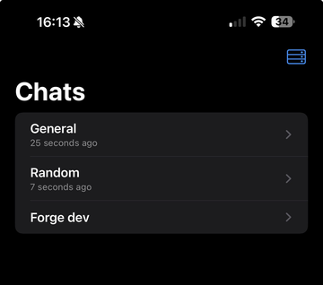
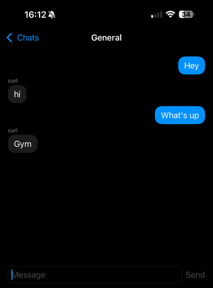

# Forge Mobile

[](https://github.com/GeneralKnowledge/ixOS/actions/workflows/rust.yml)
[](https://github.com/GeneralKnowledge/ixOS/actions/workflows/android.yml)
[](https://github.com/GeneralKnowledge/ixOS/actions/workflows/macos.yml)

Linux-first, Rust-first framework for building native mobile apps with **Rust** (domain logic), **UniFFI** (FFI), and thin platform hosts: **SwiftUI + xtool** (iOS) and **Jetpack Compose + Gradle** (Android).

This repository (`ixOS` on GitHub) ships a working **Counter** example, a networked **Weather** example (iOS), a **Chat** demo on both iOS and Android (live event stream, room subscriptions, offline retry; see [docs/chat-demo.md](docs/chat-demo.md)), **Pocket Library**, a multi-screen reading tracker made with `forge init` that owns its Rust crate ([examples/pocket-library](examples/pocket-library/README.md)), a developer CLI, scripts, and documentation. It is an integration reference, not a full mobile platform yet; see [docs/roadmap.md](docs/roadmap.md) for what comes next and where help is welcome.

The Rust-to-Swift bridge is asynchronous: SwiftUI talks to a thin Swift layer (`CounterBridge`) that exposes Rust commands and queries as `async` calls and Rust events as an `AsyncSequence`, with explicit cancellation and typed errors. See [docs/architecture.md](docs/architecture.md) and [docs/ffi-policy.md](docs/ffi-policy.md).

<p>
  
  
</p>

The [Chat example](docs/chat-demo.md) on an iPhone, built and installed from Linux with xtool, talking to the local chat server (the grey bubbles were posted from another client).

## Why Forge?

Forge is for teams that want **native UI on each platform** (SwiftUI, Jetpack Compose) over **one Rust core**, and want to do most of that work **from Linux**. It is not a cross-platform UI toolkit: you write each app's UI in its own language, and Forge supplies the shared core, the FFI contract (async commands, events, cancellation, typed errors), the packaging scripts, a CLI and templates.

How it compares, briefly and honestly. **[Tauri](https://tauri.app/)** (webview UI) and **[Dioxus](https://dioxuslabs.com/)** (Rust UI) give you one UI for all platforms and are far more mature; **[Bevy](https://bevyengine.org/)** is a game engine with its own renderer. All three expect a Mac with Xcode for iOS builds today, while Forge builds and installs iOS apps from Linux through [xtool](https://github.com/xtool-org/xtool) (macOS with Xcode also works). **Plain [UniFFI](https://mozilla.github.io/uniffi-rs/)** is what Forge uses underneath; with UniFFI alone you write the iOS/Android packaging, binding regeneration, drift checks, host app wiring and the threading contract yourself. Pick Forge if native UI and a Linux-first workflow matter more to you than a shared UI or a large ecosystem; pick Tauri or Dioxus if you want one UI codebase; pick Bevy for games.

## Quick start (Linux)

1. Install [Rust](https://www.rust-lang.org/), [Swift](https://www.swift.org/) and [xtool](https://github.com/xtool-org/xtool), then run `xtool setup` with an **Xcode.xip** (Xcode 26) to install the Darwin SDK. See [docs/linux-setup.md](docs/linux-setup.md). For Android, install the SDK, NDK and `cargo-ndk` ([docs/android-setup.md](docs/android-setup.md)).
2. Install the CLI and check the machine: `cargo install --path crates/forge-cli --locked`, then `forge doctor`. It reports which workflows are ready (Rust, iOS from Linux with xtool, Android) and how to fix each missing piece.
3. Create an app outside the checkout and run it. It gets its own Rust crate for your logic:

   ```bash
   cd ~/projects
   forge init MyApp --bundle-id org.example.myapp   # add --platform android for Android
   cd MyApp
   forge run ios                  # build with xtool, sign and install on a connected iPhone; open it from the home screen
   forge test                     # your Rust tests (plus XCTest on macOS, JVM tests for Android)
   forge build android --install  # (Android app) debug APK on a connected phone
   ```

   `forge run ios` checks the toolchain, your Apple sign-in and the iPhone before it builds, and a failed build or install ends with what went wrong and how to fix it.

4. Edit `rust/src/lib.rs`, and the SwiftUI or Compose screens. `forge run` / `forge build` rebuild the Rust and regenerate the bindings. See [docs/app-crate.md](docs/app-crate.md) for the Rust side and [docs/ios-ui.md](docs/ios-ui.md) for building a native iOS interface.
5. Set the app's name, version, icon, permission prompts, URL schemes and entitlements in `forge.toml`; Forge writes Info.plist, App.entitlements and xtool.yml from it ([docs/app-config.md](docs/app-config.md)).

New to Forge? [docs/getting-started.md](docs/getting-started.md) walks through all of this from a bare Linux machine to the app on your iPhone, including the one-time iPhone steps (Trust, Developer Mode, Apple sign-in).

To try the bundled examples instead: `forge run ios --project examples/chat` (start `make chat-server ARGS="--bind 0.0.0.0:8787"` first), or `forge build android --project examples/chat-android --install`.

[docs/builds.md](docs/builds.md) lists what each build produces: xtool or Xcode, device or simulator, debug or release, and what is not supported yet. A Mac with Xcode works too ([docs/ios-xcode.md](docs/ios-xcode.md)) but is never required.

Contributing? [CONTRIBUTING.md](CONTRIBUTING.md) starts with a three-command path to a green local build.

CI runs, on Ubuntu, the Rust checks, binding drift, a fresh `forge init` app outside the checkout, and, when Android or shared Rust code changes, Android JVM tests and a **debug APK**. On macOS it runs the Swift host tests and unsigned `xcodebuild` device builds of Chat, Pocket Library and freshly generated apps. Simulator screenshots of the starter app and Pocket Library run only when their Swift UI changes, or by hand (`.github/workflows/screenshots.yml`). No CI job exercises the xtool build itself: Xcode's Darwin SDK cannot be redistributed, so that path is checked on a device. Physical devices are checked by hand ([docs/toolchain-validation.md](docs/toolchain-validation.md)).

## Repository layout

```
crates/forge-storage   # Atomic file writes and versioned JSON documents
crates/forge-net       # HttpClient trait, test doubles, ureq HTTPS client (feature `ureq`)
crates/forge-runtime   # What an app's own Rust crate builds on: background work, event streams, Android HTTPS init
crates/forge-services  # Native services for apps: Keychain, files, notifications, permissions, sharing, deep links (docs/native-services.md)
crates/forge-cli       # `forge` CLI
examples/counter          # SwiftUI + xtool app; its rust/ crate holds the counter rules and store
examples/weather          # SwiftUI weather + location app: real HTTP, nested FFI types, cancellation
examples/counter-android  # Compose + Gradle app on the same Rust crate as examples/counter
examples/chat             # SwiftUI chat app: long-lived event stream, room subscriptions, retry (see docs/chat-demo.md)
examples/chat-android     # The chat app in Compose (frozen at its pre-M0 features, own rust/ crate)
examples/chat-core        # Chat demo's Rust core: SSE event stream, subscriptions, store
examples/pocket-library   # Reading tracker from forge init: own Rust crate, catalogue search, EPUB import
templates/app-rust        # Starter Rust crate every new app gets as rust/ (see docs/app-crate.md)
templates/ios-app         # `forge init --platform ios`
templates/android-app     # `forge init --platform android`
scripts/               # Toolchain and build scripts
docs/                  # Architecture, setup, validation
```

## Forge CLI

```bash
cargo run -p forge-cli -- doctor          # what this machine can build, with a fix for each missing piece
cargo run -p forge-cli -- doctor --json   # the same report as JSON, for CI and scripts
cargo run -p forge-cli -- check           # full local CI matrix (or: make check)
cargo run -p forge-cli -- init MyApp --bundle-id org.example.myapp --platform ios
cargo run -p forge-cli -- init MyApp --path ~/projects/MyApp      # create the app outside the workspace
cargo run -p forge-cli -- test   # workspace tests + rustfmt check
cargo run -p forge-cli -- test --project examples/counter-android  # ...plus that app's host tests
cargo run -p forge-cli -- bindings generate --project ~/projects/MyApp   # an app's own crate -> its Generated/
cargo run -p forge-cli -- bindings generate --project examples/counter-android   # Kotlin, for an Android app
cargo run -p forge-cli -- build ios --project examples/counter       # xtool dev build
cargo run -p forge-cli -- run ios --project examples/counter         # build and install (xtool dev run); open it on the phone
cargo run -p forge-cli -- run ios --project examples/counter --release  # same, Swift release configuration
cargo run -p forge-cli -- build ios --project examples/counter --package-only  # Rust + bindings only (Xcode on macOS)
cargo run -p forge-cli -- build android --project examples/counter-android
cargo run -p forge-cli -- devices
```

Install the binary: `cargo install --path crates/forge-cli --locked` (optional). The installed `forge` finds the workspace from the current directory (any folder inside the Forge checkout), or from `FORGE_WORKSPACE` if set. New apps go under the workspace's `examples/` unless you pass `--path <dir>`; an app created outside the checkout points its build files at the checkout by absolute path.

## Configuration

Example apps include `forge.toml` — see [examples/counter/forge.toml](examples/counter/forge.toml).

New apps: `forge init MyApp --bundle-id org.example.myapp --platform ios|android --path ~/projects/MyApp`. Each app owns its Rust logic in its own crate (`rust/`), so you never edit Forge's crates to build one. See [docs/project-generation.md](docs/project-generation.md) and [docs/app-crate.md](docs/app-crate.md).

## License

Dual licensed under **MIT OR Apache-2.0** — see [LICENSE-MIT](LICENSE-MIT) and [LICENSE-APACHE](LICENSE-APACHE).

## Known limitations

- iOS builds are device-only: no iOS Simulator support yet. Linux iOS builds need xtool's Darwin SDK (from an Xcode.xip).
- Development builds only: debug APKs on Android, xtool or Xcode development builds on iOS. No App Store or Google Play distribution yet ([docs/builds.md](docs/builds.md)).
- Apps need a Forge checkout on the same machine: the runtime crates are not published to crates.io yet.
- Android has not yet been validated on a physical phone; CI builds the APK and runs the JVM tests.
- Networking is demonstrated by the iOS Weather example ([examples/weather](examples/weather/README.md)) and the Chat example on both hosts ([examples/chat](examples/chat/README.md), [examples/chat-android](examples/chat-android/README.md)). HTTPS certificates are checked with each platform's trust store; on Android the host calls `ForgeAndroid.init(applicationContext)` once at startup ([docs/android-setup.md](docs/android-setup.md#https-certificate-verification)).

- `rust-toolchain.toml` pins Rust; rustup picks it up automatically.
- `environment.json` bootstraps hosted coding-agent VMs (Ubuntu 24.04): its `install` command installs Swift, xtool, usbmuxd and the iOS Rust target, then runs `cargo fetch`. It is not machine-specific and is not needed for local development. See [docs/linux-setup.md](docs/linux-setup.md#hosted-agent-vms-environmentjson).
- `deny.toml` configures `cargo deny check` (advisories, licenses, sources).
