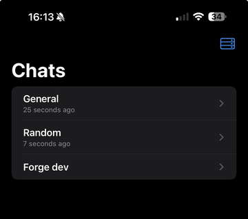
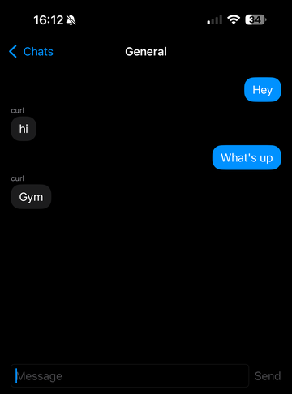

# Forge Mobile

[](https://github.com/GeneralKnowledge/ixOS/actions/workflows/rust.yml)
[](https://github.com/GeneralKnowledge/ixOS/actions/workflows/android.yml)

Linux-first, Rust-first framework for building native mobile apps with **Rust** (domain logic), **UniFFI** (FFI), and thin platform hosts: **SwiftUI + xtool** (iOS) and **Jetpack Compose + Gradle** (Android).

> **Platform focus: iOS.** Android is **work in progress**, moving forward only as a capped side track: Pocket Library is being brought to parity on Android one milestone at a time, never ahead of iOS work. The rest of the Android code and the template stay and keep building in CI without new features, Android has not been validated on a physical phone, and new capabilities land on iOS first. See [the roadmap](docs/roadmap.md#android--work-in-progress).

This repository (`ixOS` on GitHub) ships **Checklist**, the smallest app on the ixOS runtime, a networked **Weather** example (iOS), a **Chat** demo (iOS, with a frozen Android twin; live event stream, room subscriptions, offline retry; see [examples/relay/docs/chat-demo.md](examples/relay/docs/chat-demo.md)), **Pocket Library**, a multi-screen reading tracker made with `forge init` that owns its Rust crate ([examples/pocket-library](examples/pocket-library/README.md)), a developer CLI, scripts, and documentation. It is an integration reference, not a full mobile platform yet; see [docs/roadmap.md](docs/roadmap.md) for what comes next and where help is welcome.

The Rust-to-Swift boundary is asynchronous: each app's Rust core runs on the ixOS runtime (`forge-app`), whose commands are `async` calls that save before they return, whose queries never wait, and whose events tell the SwiftUI host (ForgeKit's `ForgeHost`) when to re-read, with explicit cancellation and typed errors. See [docs/architecture.md](docs/architecture.md) and [docs/ffi-policy.md](docs/ffi-policy.md).

<p>
  
  
</p>

The [Chat example](examples/relay/docs/chat-demo.md) on an iPhone, built and installed from Linux with xtool, talking to the local chat server (the grey bubbles were posted from another client).

## Why Forge?

Forge is for teams that want **native UI on each platform** (SwiftUI, Jetpack Compose) over **one Rust core**, and want to do most of that work **from Linux**. It is not a cross-platform UI toolkit: you write each app's UI in its own language, and Forge supplies the shared core, the FFI contract (async commands, events, cancellation, typed errors), the packaging scripts, a CLI and templates.

How it compares, briefly and honestly. **[Tauri](https://tauri.app/)** (webview UI) and **[Dioxus](https://dioxuslabs.com/)** (Rust UI) give you one UI for all platforms and are far more mature; **[Bevy](https://bevyengine.org/)** is a game engine with its own renderer. All three expect a Mac with Xcode for iOS builds today, while Forge builds and installs iOS apps from Linux through [xtool](https://github.com/xtool-org/xtool) (macOS with Xcode also works). **Plain [UniFFI](https://mozilla.github.io/uniffi-rs/)** is what Forge uses underneath; with UniFFI alone you write the iOS/Android packaging, binding regeneration, drift checks, host app wiring and the threading contract yourself. Pick Forge if native UI and a Linux-first workflow matter more to you than a shared UI or a large ecosystem; pick Tauri or Dioxus if you want one UI codebase; pick Bevy for games.

## Quick start (Linux)

1. Install [Rust](https://www.rust-lang.org/) and download **Xcode 26** as a `.xip` from Apple (you don't install it; Forge uses the iOS SDK inside). `forge setup ios --xip <Xcode.xip>` (step 2) installs Swift, [xtool](https://github.com/xtool-org/xtool), USB support and the SDK; [docs/linux-setup.md](docs/linux-setup.md) has the same steps by hand. Android is work in progress; if you want to try it anyway, install the SDK, NDK and `cargo-ndk` ([docs/android-setup.md](docs/android-setup.md)).
2. Clone this repository (`git clone https://github.com/GeneralKnowledge/ixOS.git ~/src/forge`; ixOS is the repository, Forge is the tool), install the CLI from it and set up the machine: `cargo install --path ~/src/forge/crates/forge-cli --locked`, then `forge setup ios --xip ~/Downloads/Xcode_26.xip`. It asks before anything needs sudo and ends with the same report as `forge doctor`, which says at any time which workflows are ready (Rust, iOS from Linux with xtool, and the work-in-progress Android path) and how to fix each missing piece.
3. Create an app outside the checkout and run it. It gets its own Rust crate for your logic:

   ```bash
   cd ~/projects
   forge init MyApp --minimal --bundle-id org.example.myapp
   cd MyApp
   forge run ios                  # build with xtool, sign and install on a connected iPhone; open it from the home screen
   forge test                     # your Rust tests (plus XCTest on macOS)
   ```

   `forge run ios` checks the toolchain, your Apple sign-in and the iPhone before it builds, and a failed build or install ends with what went wrong and how to fix it.

4. Edit `rust/src/lib.rs`, and the SwiftUI or Compose screens. `forge run` / `forge build` rebuild the Rust and regenerate the bindings. See [docs/app-crate.md](docs/app-crate.md) for the Rust side and [docs/ios-ui.md](docs/ios-ui.md) for building a native iOS interface.
5. Set the app's name, version, icon, permission prompts, URL schemes and entitlements in `forge.toml`; Forge writes Info.plist, App.entitlements and xtool.yml from it ([docs/app-config.md](docs/app-config.md)).

The docs have one entry page per area, [framework](docs/framework.md), [tools](docs/tools.md), [infrastructure](docs/infrastructure.md) and [apps](examples/README.md), all listed in [docs/README.md](docs/README.md), and [docs/status.md](docs/status.md) says what works on an iPhone today.

`--minimal` starts from a one-screen app to learn from, and [docs/first-app.md](docs/first-app.md) adds a feature to it in about 20 minutes. Leave it out for the full starter, a multi-screen notes app that shows events, networking, the app lifecycle and native services. [docs/getting-started.md](docs/getting-started.md) walks through all of this from a bare Linux machine to the app on your iPhone, including the one-time iPhone steps (Trust, Developer Mode, Apple sign-in).

To try the bundled examples instead: `forge run ios --project examples/relay` (start `make chat-server ARGS="--bind 0.0.0.0:8787"` first). The Android example (`examples/pocket-library-android`) is work in progress.

[docs/builds.md](docs/builds.md) lists what each build produces: xtool or Xcode, device or simulator, debug or release, and what is not supported yet. A Mac with Xcode works too ([docs/ios-xcode.md](docs/ios-xcode.md)) but is never required.

Contributing? [CONTRIBUTING.md](CONTRIBUTING.md) starts with a three-command path to a green local build.

CI runs, on Ubuntu, the Rust checks, binding drift, a fresh `forge init` app outside the checkout, and, when Android or shared Rust code changes, Android JVM tests and a **debug APK**. Pull requests are gated by Linux only. A macOS job (Swift host tests and unsigned `xcodebuild` device builds) runs weekly and on demand. Simulator screenshots run by hand (`.github/workflows/screenshots.yml`). Docs-only changes run nothing; see [CONTRIBUTING.md](CONTRIBUTING.md#ci). No hosted CI job runs the xtool build, because Xcode's Darwin SDK cannot be redistributed. `scripts/check-ios-xtool.sh` builds every affected app with xtool on a Linux machine that has the SDK ([docs/ios-build-check.md](docs/ios-build-check.md)). Physical devices are checked by hand ([docs/toolchain-validation.md](docs/toolchain-validation.md)).

## Repository layout

```
crates/forge-app       # The application runtime every new iOS app's core embeds: ordered commands that save, then announce; lifecycle; cancellation; shutdown (docs/app-model-review.md)
forgekit/              # ForgeKit, its Swift half: hosts the Rust core, reports the lifecycle, runs the event loop. Released to GeneralKnowledge/ForgeKit
crates/forge-storage   # Atomic file writes, versioned JSON documents, SQLite (feature `sqlite`)
crates/forge-net       # HttpClient trait, test doubles, ureq HTTPS client (feature `ureq`)
crates/forge-runtime   # What an app's own Rust crate builds on: background work, event streams, lifecycle, app_shell!, logging, Android HTTPS init
crates/forge-device    # `forge device`: a connected iPhone's details, logs and crash reports from Linux (docs/forge-device.md)
crates/forge-uitest    # `forge ui`: drive an app on a connected iPhone from Linux by accessibility identifier, through XCTest and WebDriverAgent (docs/forge-ui-testing.md)
crates/forge-devproto  # an encrypted channel over a byte stream: frames, Noise handshake, messages (Relay uses it)
crates/forge-services  # Native services for apps: Keychain, files, notifications, permissions, sharing, deep links (docs/native-services.md)
crates/forge-cli       # `forge` CLI
examples/checklist        # The first app on the runtime and ForgeKit
examples/weather          # SwiftUI weather + location app: real HTTP, nested FFI types, cancellation
examples/relay             # SwiftUI chat app: long-lived event stream, room subscriptions, retry (see examples/relay/docs/chat-demo.md)
examples/relay/messaging/chat-core        # Chat demo's Rust core: SSE event stream, subscriptions, store
examples/pocket-library   # Reading tracker from forge init: own Rust crate, catalogue search, EPUB import
templates/app-rust        # Starter Rust crate every new iOS app gets as rust/, on forge-app (see docs/app-crate.md)
templates/android-rust    # Android's starter crate (work in progress, the shape from before forge-app)
templates/ios-app         # `forge init --platform ios`
templates/android-app     # (Android, work in progress) `forge init --platform android`
scripts/               # Toolchain and build scripts
docs/                  # Docs: framework.md, tools.md and infrastructure.md are the entry pages
```

## Forge CLI

```bash
cargo run -p forge-cli -- doctor          # what this machine can build, with a fix for each missing piece
cargo run -p forge-cli -- setup ios --xip ~/Downloads/Xcode_26.xip   # install the Linux iOS toolchain; asks before sudo, safe to rerun
cargo run -p forge-cli -- doctor --json   # the same report as JSON, for CI and scripts
cargo run -p forge-cli -- check           # full local CI matrix (or: make check)
cargo run -p forge-cli -- init MyApp --bundle-id org.example.myapp --platform ios
cargo run -p forge-cli -- init MyApp --path ~/projects/MyApp      # create the app outside the workspace
cargo run -p forge-cli -- test   # workspace tests + rustfmt check
cargo run -p forge-cli -- test --project examples/pocket-library-android  # ...plus that app's host tests
cargo run -p forge-cli -- bindings generate --project ~/projects/MyApp   # an app's own crate -> its Generated/
cargo run -p forge-cli -- bindings generate --project examples/pocket-library-android   # Kotlin, for an Android app
cargo run -p forge-cli -- build ios --project examples/pocket-library  # xtool dev build
cargo run -p forge-cli -- run ios --project examples/pocket-library    # build and install (xtool dev run); open it on the phone
cargo run -p forge-cli -- diagnose --project examples/pocket-library   # the app is installed but doesn't work: checks it and says what to do next
cargo run -p forge-cli -- run ios --project examples/pocket-library --release  # same, Swift release configuration
cargo run -p forge-cli -- build ios --project examples/pocket-library --package-only  # Rust + bindings only (Xcode on macOS)
cargo run -p forge-cli -- build android --project examples/pocket-library-android
cargo run -p forge-cli -- devices
cargo run -p forge-cli -- check swift --project examples/pocket-library   # model + bindings with plain Swift on Linux (not the SwiftUI views)
cargo run -p forge-cli -- --json run ios --project examples/pocket-library   # one forge.result/1 object on stdout, exit code per stage
cargo run -p forge-cli -- device logs --process PocketLibraryXtool --for 20s    # the app's log on a USB iPhone (docs/forge-device.md)
```

## Without an agent, and with one

Everything Forge does is a `forge` command a person runs at a terminal: [docs/human-workflow.md](docs/human-workflow.md) takes a fresh app from `forge init` to reviewed evidence with no AI agent, MCP server or API key, and CI runs it. AI coding agents use the same commands; the integration below is optional.

An agent edits Rust and SwiftUI with its own tools; Forge gives it the toolchain, signing, the phone and structured results. What exists today:

Where each of these stands on a real iPhone is kept current in [docs/status.md](docs/status.md).

| | State |
|---|---|
| `--json` on every command (`forge.result/1`: stage, compiler diagnostics with file and line, hints, log file) | Built |
| `forge check swift`: the view model and bindings compiled and tested with plain Swift on Linux | Built. SwiftUI views still need the Darwin SDK: `scripts/check-ios-xtool.sh` with xtool |
| An MCP server over these commands, an explorer that walks an app's screens, run records and a live connection to development builds | Moved to the [forge-lab](https://github.com/GeneralKnowledge/forge-lab) side project, which depends on ixOS |
| Which Apple team signs, free or paid, in `forge doctor` and `forge run ios` | Built; not yet run with a paid team ([docs/ios-signing.md](docs/ios-signing.md#which-team-is-xtool-using)) |
| UI tests by accessibility identifier on a real iPhone (WebDriverAgent, `forge ui`) | Built. On an iPhone: setup, launch, finding by identifier, tapping, typing, the tree and screenshots work (a UI test passed 11 of 11 steps). Needs Settings > Developer > Enable UI Automation on the phone ([docs/forge-ui-testing.md](docs/forge-ui-testing.md)) |
| Apple's accessibility service from Linux (no runner or disk image) | Experimental probe: reading identifiers and labels and pressing by identifier work on an iPhone; no typing, and Apple's audit doesn't answer yet ([docs/research/ax-audit.md](docs/research/ax-audit.md)) |

New apps from `forge init` have no agent files. `forge agent setup` (or `forge init --agent`) adds `AGENTS.md` (the rules) and `CLAUDE.md`.

Install the binary: `cargo install --path crates/forge-cli --locked` (optional). The installed `forge` finds the workspace from the current directory (any folder inside the Forge checkout), or from `FORGE_WORKSPACE` if set. `forge init` creates the app in `./<NAME>`, or under the workspace's `examples/` when run inside the checkout, unless you pass `--path <dir>`; an iOS app created outside the checkout pins the Forge crates and ForgeKit to the release in `forge-release.toml` (or, while the checkout has unreleased framework changes, points at the checkout by absolute path; see docs/project-generation.md).

## Configuration

Example apps include `forge.toml` — see [examples/pocket-library/forge.toml](examples/pocket-library/forge.toml).

New apps: `forge init MyApp --bundle-id org.example.myapp --platform ios|android --path ~/projects/MyApp`. Each app owns its Rust logic in its own crate (`rust/`), so you never edit Forge's crates to build one. See [docs/project-generation.md](docs/project-generation.md) and [docs/app-crate.md](docs/app-crate.md).

## License

Dual licensed under **MIT OR Apache-2.0** — see [LICENSE-MIT](LICENSE-MIT) and [LICENSE-APACHE](LICENSE-APACHE).

## Known limitations

- iOS builds are device-only: no iOS Simulator support yet. Linux iOS builds need the Darwin SDK, Apple's iOS SDK, which `forge setup ios` takes from an Xcode.xip.
- Development builds only: debug APKs on Android, xtool or Xcode development builds on iOS. No App Store or Google Play distribution yet ([docs/builds.md](docs/builds.md)). The plan for the first App Store release, and which of its steps need a Mac, is [docs/first-app-store-release.md](docs/first-app-store-release.md).
- Apps need a Forge checkout on the same machine: the runtime crates are not published to crates.io yet.
- Android is work in progress: it has not been validated on a physical phone, gets no new features, and has none of the `forge-services` native services. CI still builds the APK and runs the JVM tests when Android or shared Rust code changes.
- Networking is demonstrated by the iOS Weather example ([examples/weather](examples/weather/README.md)) and the Chat example ([examples/relay](examples/relay/docs/messaging.md)). HTTPS certificates are checked with each platform's trust store; on Android the host calls `ForgeAndroid.init(applicationContext)` once at startup ([docs/android-setup.md](docs/android-setup.md#https-certificate-verification)).

- `rust-toolchain.toml` pins Rust; rustup picks it up automatically.
- `environment.json` bootstraps hosted coding-agent VMs (Ubuntu 24.04): its `install` command installs Swift, xtool, usbmuxd and the iOS Rust target, then runs `cargo fetch`. It is not machine-specific and is not needed for local development. See [docs/linux-setup.md](docs/linux-setup.md#hosted-agent-vms-environmentjson).
- `deny.toml` configures `cargo deny check` (advisories, licenses, sources).
